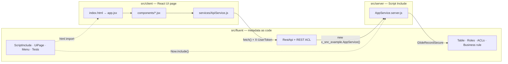

<p align="center">
  
</p>

<h1 align="center">ServiceNow App Template</h1>

<p align="center">
  <a href="https://github.com/jschuller/sn-app-template/releases/latest"></a>
  <a href="https://github.com/jschuller/sn-app-template/actions/workflows/ci.yml"></a>
  <a href="https://www.npmjs.com/package/@servicenow/sdk"></a>
  <a href="docs/compatibility.md"></a>
  <a href="LICENSE"></a>
</p>

<p align="center">
  A starting point for ServiceNow scoped apps built from source with the ServiceNow SDK (Fluent)<br>
  and an AI coding agent — <strong>Claude Code, Codex, Pi</strong> or any agent that reads <code>AGENTS.md</code>.
</p>

---

The template is a small, complete app — a table, a secured REST API, a React UI page, ACLs, roles, a business rule and
ATF tests — plus the instructions and skills that let a coding agent extend it the right way. Everything deploys with
one command. The server side — install, ACLs, REST API, business rule, ATF — was verified on a ServiceNow Brazil
instance; [docs/compatibility.md](docs/compatibility.md) lists exactly what was and was not checked.

## Quick start

Prerequisites: Node.js 20.18+ (24 recommended, see `.nvmrc`), a ServiceNow instance you may install apps on (a free
[Personal Developer Instance](https://developer.servicenow.com) works), and its vendor prefix — the
`glide.appcreator.company.code` system property (on a PDI: the company code shown in the developer portal).

1. Click **Use this template** on GitHub, then clone your new repository.
2. Install and make the app yours. The scope **must** use your instance's vendor prefix — instances refuse to install
   apps with another vendor's prefix, including the template's default scope:
   ```bash
   npm ci
   npm run setup -- --scope x_<vendor>_<app> --name "My App"   # e.g. x_1234_assets "Asset Tracker"
   ```
   `setup` renames the scope everywhere, generates a new `scopeId`, resets the version to 0.1.0 and deletes the
   template's record keys so your app gets its own sys_ids.
3. Authenticate (OAuth is recommended; credentials stay in your OS keychain):
   ```bash
   npx now-sdk auth --add https://<instance>.service-now.com --type oauth --alias dev
   ```
4. Build, deploy and test:
   ```bash
   npm run build                          # commit the new src/fluent/generated/keys.ts
   npm run deploy -- --auth dev
   npm run test:instance -- --auth dev    # ATF suite; see TROUBLESHOOTING if it reports "disabled"
   ```
5. Open `https://<instance>.service-now.com/<scope>_app.do`, or find the app under its name in the navigator.

## What gets deployed

| Component | Count | Details |
|---|---|---|
| Table | 1 | Example Item: name, description, category (choice), priority |
| Roles | 2 | `x_snc_example.user`; `x_snc_example.admin` contains user |
| Record ACLs | 4 | read and create for user; write and delete for admin |
| REST endpoint ACL | 1 | Every API route requires the user role |
| Scripted REST API | 4 routes | List (paged), create, update, delete — validated, status codes 200/201/204/400/403/404 |
| Script Include | 1 | `AppService`: CRUD through `GlideRecordSecure` so ACLs apply to the caller |
| Business rule | 1 | Derives a default priority from the category |
| UI page | 1 | React (BYOUI): paged list, create, inline edit and delete where the user's ACLs allow |
| Application menu | 1 menu, 2 modules | UI page and list view, visible to the user role |
| Cross-scope privileges | 9 | The platform APIs the code calls; the app runs with runtime access **enforcing** |
| ATF tests | 2 in 1 suite | Business rule and service; ACLs deny a user without roles |
| Demo records | 3 | Loaded as demo data (`--demoData false` skips them) |

## Architecture



```
src/
├── client/                      React UI page, bundled by the SDK
│   ├── index.html               <sdk:now-ux-globals>, -polaris, uxpcb cache-buster
│   ├── app.jsx                  React entry
│   ├── components/              App, ItemForm, ItemTable, ItemRow (+ App.css, Horizon theme variables)
│   └── services/ApiService.js   fetch() client for the Scripted REST API
├── server/AppService.server.js  Validated, ACL-enforced CRUD
└── fluent/                      One folder per metadata type; index.now.ts imports them all
    ├── tables/  roles/  acls/  business-rules/  script-includes/  rest-api/
    ├── privileges/  ui-pages/  navigation/  records/  tests/
    └── generated/keys.ts        Record keys → sys_ids (generated; commit it)
scripts/setup.mjs                Make the template your app (scope, scopeId, name)
scripts/sync-skills.mjs          Mirror .agents/skills → .claude/skills
```

## AI coding agents

The repository speaks the conventions the major coding agents read:

| File | Read by | Purpose |
|---|---|---|
| `AGENTS.md` | Codex, Pi, Copilot, Cursor, Gemini CLI, … | Architecture, commands, rules, recipes |
| `CLAUDE.md` | Claude Code | Imports `AGENTS.md`, adds Claude-specific notes |
| `.agents/skills/` | Codex, Pi, other [Agent Skills](https://agentskills.io) clients | `add-table`, `deploy-and-verify` |
| `.claude/skills/` | Claude Code | Copies of the above (`npm run sync:skills`; CI checks they match) |
| `.mcp.json.example`, `.pi/mcp.json.example` | Claude Code, Pi | Optional read-only instance access through [mcp-server-servicenow](https://github.com/jschuller/mcp-server-servicenow) |

The agents' Fluent knowledge comes from the SDK itself: `npx now-sdk explain <topic>` serves documentation that
matches the installed SDK version, so it does not drift the way copied docs do. ServiceNow also publishes an official
agent skill for the SDK ([ServiceNow/sdk](https://github.com/ServiceNow/sdk)):

- **Claude Code:** `/plugin install servicenow-sdk@claude-plugins-official`
- **Codex:** `$skill-installer https://github.com/ServiceNow/sdk/tree/master/skills/now-sdk`
- **Pi:** copy `skills/now-sdk/` from that repository into `.agents/skills/` (or `~/.agents/skills/`)

For MCP access, copy the example for your agent, export `SERVICENOW_INSTANCE_URL`, `SERVICENOW_USERNAME` and
`SERVICENOW_PASSWORD` (a dedicated integration user, not `admin`), and keep `SERVICENOW_READ_ONLY=true` unless a task
needs writes. Codex reads MCP servers from `~/.codex/config.toml`:

```toml
[mcp_servers.servicenow]
command = "uvx"
args = ["mcp-server-servicenow==0.7.0"]
env = { SERVICENOW_AUTH_TYPE = "basic", SERVICENOW_READ_ONLY = "true" }
env_vars = ["SERVICENOW_INSTANCE_URL", "SERVICENOW_USERNAME", "SERVICENOW_PASSWORD"]
```

## Commands

| Command | What it does |
|---|---|
| `npm run setup -- --scope … --name …` | Turn the template into your app (once) |
| `npm run lint` | ESLint for the UI, the Script Include and the scripts |
| `npm test` | Unit tests (`node:test`) in `tests/`, including `npm run setup` on a temporary copy |
| `npm run build` | Compile Fluent and bundle the UI into `dist/` |
| `npm run build:ci` | Build with `--frozenKeys` (fails if `keys.ts` is stale) |
| `npm run deploy -- --auth <alias>` | Install on an instance |
| `npm run test:instance -- --auth <alias>` | Run the ATF suite on the instance |
| `npm run pack` | Package the app as an installable zip in `target/` |

## CI deploy (optional)

`.github/workflows/ci.yml` lints, runs `npm test`, builds with frozen keys and packages on every pull request and every push to
`main`. Its `instance-test` job also deploys to a **test** instance on pushes to `main` and runs the ATF suite once
you add the repository variable
`SN_SDK_INSTANCE_URL` and the secrets `SN_SDK_OAUTH_CLIENT_ID` / `SN_SDK_OAUTH_CLIENT_SECRET` (OAuth client
credentials; setup in `npx now-sdk explain ci-integration`). Promote to production through the Application Repository
(`now-sdk cicd publish` / `cicd install`), not with `now-sdk install`.

## Documentation

- [AGENTS.md](AGENTS.md) — how the app is built and the rules for changing it
- [docs/compatibility.md](docs/compatibility.md) — verified releases, Brazil notes, SDK upgrade steps
- [TROUBLESHOOTING.md](TROUBLESHOOTING.md) — install, auth, REST, UI page and ATF problems
- [CHANGELOG.md](CHANGELOG.md) · [RELEASING.md](RELEASING.md) · [CONTRIBUTING.md](CONTRIBUTING.md) · [SECURITY.md](SECURITY.md)
- ServiceNow: [ServiceNow SDK](https://www.servicenow.com/docs/csh?topicname=servicenow-sdk-landing&version=latest), [SDK docs site](https://servicenow.github.io/sdk/),
  [SDK releases](https://github.com/ServiceNow/sdk/releases), [SDK examples](https://github.com/ServiceNow/sdk-examples),
  [Brazil release notes](https://www.servicenow.com/docs/r/release-notes/rn-learn-landing-page.html)

## Related projects

- [mcp-server-servicenow](https://github.com/jschuller/mcp-server-servicenow) — MCP server for ServiceNow (19 tools) with
  read-only mode and table allow/deny lists.
- [ServiceNow/sdk-examples](https://github.com/ServiceNow/sdk-examples) — official samples for individual SDK features.

## License

[MIT](LICENSE)
